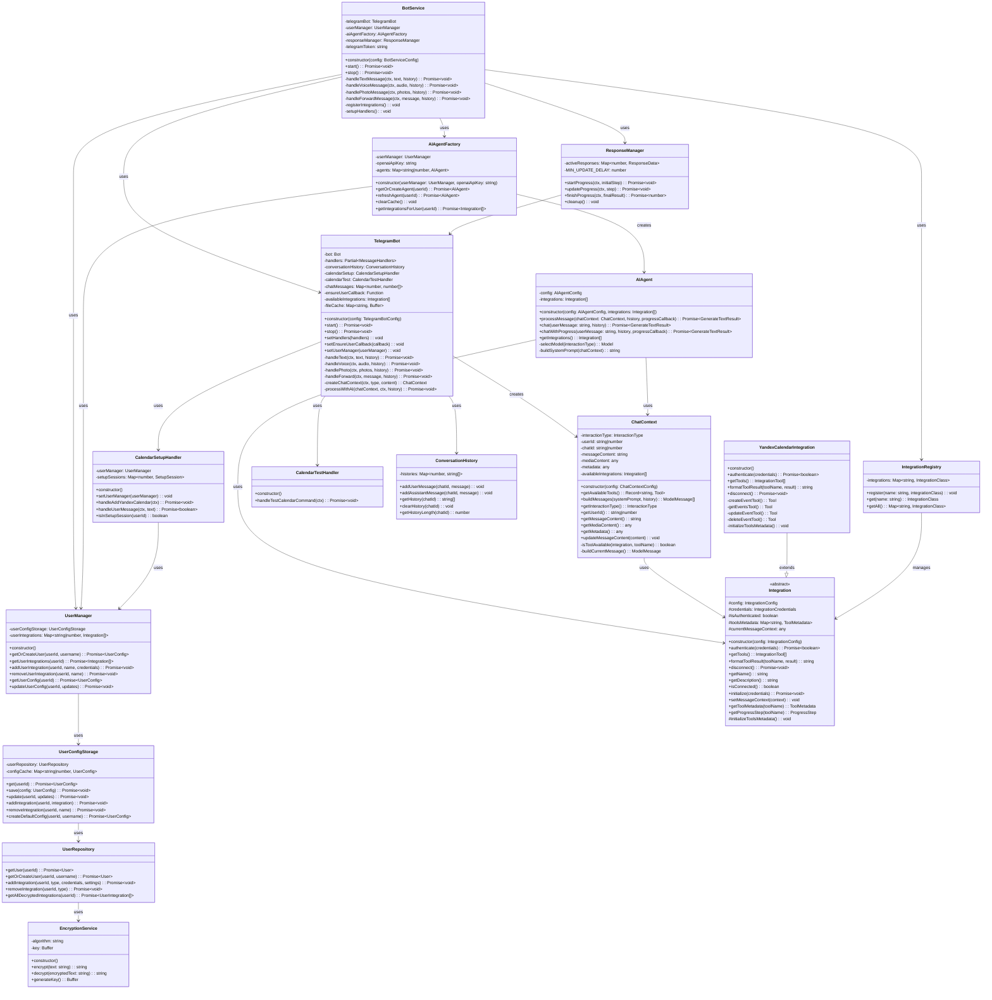
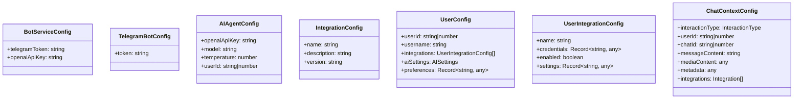

# Диаграмма классов TypeScript приложения

## Основная архитектура



## Типы взаимодействий

```mermaid
enumeration InteractionType {
    TEXT
    VOICE
    IMAGE
    FORWARD
}
```

## Конфигурации



## Основные паттерны архитектуры

1. **Factory Pattern**: `AIAgentFactory` создает AI агентов с нужными интеграциями
2. **Registry Pattern**: `IntegrationRegistry` управляет доступными интеграциями
3. **Strategy Pattern**: Разные типы взаимодействий обрабатываются по-разному
4. **Observer Pattern**: `ResponseManager` отслеживает прогресс обработки
5. **Repository Pattern**: `UserRepository` абстрагирует работу с базой данных
6. **Template Method**: `Integration` определяет общий интерфейс для всех интеграций

## Поток обработки сообщений

1. `TelegramBot` получает сообщение
2. Создается `ChatContext` с контекстом сообщения
3. `BotService` получает AI агента через `AIAgentFactory`
4. `AIAgent` обрабатывает сообщение с помощью доступных интеграций
5. `ResponseManager` показывает прогресс пользователю
6. Результат отправляется обратно через `TelegramBot`
